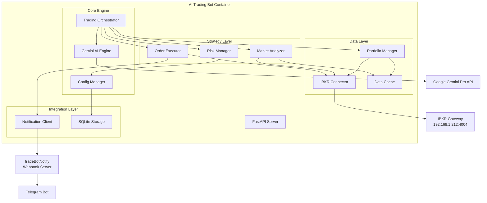
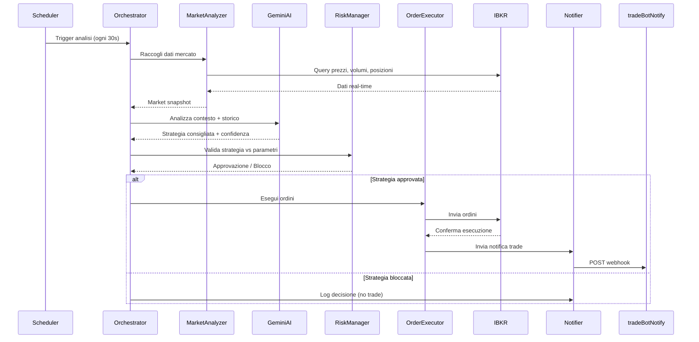
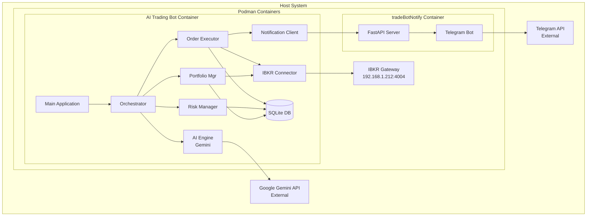
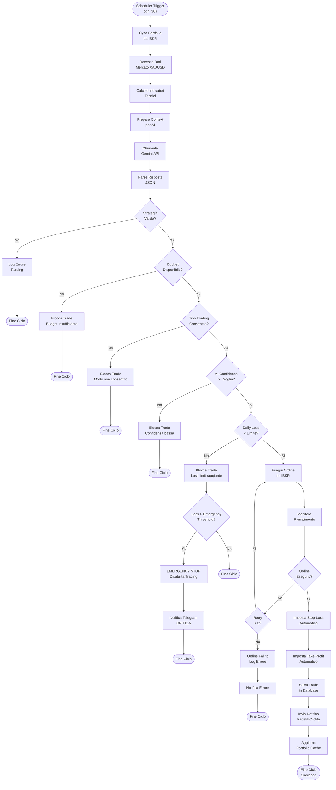

# 🤖 AI Trading Bot - Piano di Progetto

**Data creazione:** 2026-10-13  
**Versione:** 1.0  
**Autore:** Zoo (Architect Mode)

---

## 📋 Indice

1. [Panoramica del Progetto](#panoramica-del-progetto)
2. [Analisi Sistema Esistente](#analisi-sistema-esistente)
3. [Architettura AI Trading Bot](#architettura-ai-trading-bot)
4. [Struttura Directory e File](#struttura-directory-e-file)
5. [Moduli Applicativi](#moduli-applicativi)
6. [Integrazione con Sistemi Esistenti](#integrazione-con-sistemi-esistenti)
7. [Containerizzazione e Deploy](#containerizzazione-e-deploy)
8. [Configurazione e Parametri](#configurazione-e-parametri)
9. [Sicurezza e Gestione Rischi](#sicurezza-e-gestione-rischi)
10. [Fasi di Implementazione](#fasi-di-implementazione)

---

## 🎯 Panoramica del Progetto

### Obiettivo

Creare un'applicazione di trading automatico basata su **intelligenza artificiale (Google Gemini Pro)** che:

- Si connette al broker Interactive Brokers tramite il container esistente
- Visualizza portafoglio, bilanci e transazioni in tempo reale
- Esegue operazioni di trading scalping aggressivo su **XAUUSD** (oro)
- Utilizza **AI per strategie dinamiche** invece di algoritmi statici
- Rispetta parametri rigidi di budget e tipo di trading per ogni titolo
- Invia notifiche al sistema tradeBotNotify esistente

### Differenza Chiave con Nautilus

| Aspetto | Nautilus Trader | AI Trading Bot |
|---------|----------------|----------------|
| **Strategia** | Algoritmi statici (EMA, RSI, ATR) | Dinamica basata su AI (Gemini Pro) |
| **Decisioni** | Regole pre-programmate | Analisi contestuale real-time |
| **Adattabilità** | Parametri fissi da aggiornare manualmente | Apprendimento continuo dal mercato |
| **Complessità** | Media (2358 righe per XAUUSD) | Alta (AI + orchestrazione) |
| **Costo operativo** | Basso (solo infrastruttura) | Medio (API Gemini Pro) |

---

## 🔍 Analisi Sistema Esistente

### Nautilus Trader - Configurazione IBKR

**Connessione Broker:**
- **Host:** `192.168.1.212`
- **Porta:** `4004`
- **Client ID range:** 10-450 (vari kernel)
- **Kernel attivi:** XAUUSD (302), SPCX (297), NVDA, IB1T

**Architettura Nautilus:**
```
Container IBKR Gateway (192.168.1.212:4004)
    ↓
Nautilus Trader Kernels (Python)
    ├── live_trading_xauusd.py (Client ID: 302)
    ├── live_trading_spcx.py (Client ID: 297)
    └── Altri kernel...
    ↓
Webhook HTTP → tradeBotNotify (porta 9008)
    ↓
Telegram Bot
```

### tradeBotNotify - Sistema Notifiche

**Funzionalità esistenti:**
- API webhook per notifiche trade (`/notify` endpoint)
- Monitoraggio mercato real-time ogni 60s
- Integrazione IBKR per dati real-time
- Bot Telegram per notifiche push
- Dashboard web (FastAPI + HTML)

**Stack tecnologico:**
- FastAPI (backend)
- Nautilus Trader (market data IBKR)
- Yahoo Finance (fallback)
- Telegram Bot API
- Docker/Podman containerizzato

---

## 🏗️ Architettura AI Trading Bot

### Stack Tecnologico Proposto

```
Python 3.12
├── FastAPI (API server + webhook client)
├── Nautilus Trader (connessione IBKR)
├── Google Gemini Pro SDK (decisioni trading)
├── SQLite (persistenza configurazioni e storico)
├── APScheduler (scheduling analisi periodiche)
└── Requests (comunicazione con tradeBotNotify)
```

### Architettura Multi-Layer



### Flusso Operativo



---

## 📁 Struttura Directory e File

### Opzione A: Dentro Workspace Nautilus

```
/home/vvelectron/VisualVibe Workdirs/Nautilus/
├── ai-trading-bot/                    # ← Nuova directory
│   ├── app/
│   │   ├── __init__.py
│   │   ├── main.py                    # Entry point FastAPI
│   │   ├── config.py                  # Configurazioni centrali
│   │   └── models.py                  # Modelli dati Pydantic
│   ├── core/
│   │   ├── __init__.py
│   │   ├── orchestrator.py            # Orchestratore principale
│   │   ├── ai_engine.py               # Integrazione Gemini Pro
│   │   └── scheduler.py               # APScheduler setup
│   ├── data/
│   │   ├── __init__.py
│   │   ├── ibkr_connector.py          # Connessione IBKR via Nautilus
│   │   ├── portfolio_manager.py       # Gestione portafoglio
│   │   ├── market_data_cache.py       # Cache dati mercato
│   │   └── database.py                # SQLite wrapper
│   ├── strategy/
│   │   ├── __init__.py
│   │   ├── market_analyzer.py         # Analisi tecnica mercato
│   │   ├── risk_manager.py            # Gestione rischi e validazione
│   │   └── order_executor.py          # Esecuzione ordini
│   ├── integration/
│   │   ├── __init__.py
│   │   ├── notification_client.py     # Client webhook tradeBotNotify
│   │   └── gemini_client.py           # Client Google Gemini API
│   ├── utils/
│   │   ├── __init__.py
│   │   ├── logger.py                  # Logging configurato
│   │   └── helpers.py                 # Utility functions
│   ├── config/
│   │   ├── trading_params.json        # Parametri rigidi per asset
│   │   ├── ai_prompts.json            # Template prompt Gemini
│   │   └── symbols.json               # Configurazione simboli
│   ├── data/
│   │   └── trading.db                 # Database SQLite
│   ├── logs/
│   │   └── ai-trader.log
│   ├── tests/
│   │   ├── test_ibkr_connection.py
│   │   ├── test_gemini_integration.py
│   │   └── test_risk_manager.py
│   ├── docker/
│   │   ├── Dockerfile
│   │   └── docker-compose.yml
│   ├── .env.example
│   ├── .gitignore
│   ├── requirements.txt
│   ├── README.md
│   └── ARCHITECTURE.md
│
├── tradeBotNotify/                    # ← Sistema esistente
├── memory-bank/                       # ← Memory bank esistente
└── live_trading_xauusd.py            # ← Kernel Nautilus esistente
```

### Opzione B: Directory Separata

```
/home/vvelectron/VisualVibe Workdirs/
├── Nautilus/                          # ← Workspace esistente
└── AI-TradingBot/                     # ← Nuovo workspace separato
    └── [stessa struttura di Opzione A]
```

**Raccomandazione:** **Opzione A** - Mantiene tutto il sistema di trading in un unico workspace, facilita la condivisione di configurazioni e la manutenzione.

---

## 🧩 Moduli Applicativi

### 1. IBKR Connector

**File:** [`data/ibkr_connector.py`](ai-trading-bot/data/ibkr_connector.py)

**Responsabilità:**
- Connessione al gateway IBKR (192.168.1.212:4004)
- Utilizzo Client ID dedicato (es: 500)
- Query posizioni portfolio in tempo reale
- Query dati mercato real-time (prezzi, volumi, spread)
- Invio ordini market/limit
- Monitoraggio stato ordini

**Tecnologia:** Nautilus Trader `InteractiveBrokersDataClientConfig` + `InteractiveBrokersExecutionClientConfig`

**Interfaccia principale:**
```python
class IBKRConnector:
    def __init__(self, host: str, port: int, client_id: int)
    def connect() -> bool
    def disconnect()
    def get_account_summary() -> Dict[str, float]
    def get_positions() -> List[Position]
    def get_market_data(symbol: str) -> MarketSnapshot
    def place_order(symbol: str, action: str, quantity: float, order_type: str) -> Order
    def get_order_status(order_id: str) -> OrderStatus
    def cancel_order(order_id: str) -> bool
```

---

### 2. Portfolio Manager

**File:** [`data/portfolio_manager.py`](ai-trading-bot/data/portfolio_manager.py)

**Responsabilità:**
- Sincronizzazione stato portfolio da IBKR
- Calcolo P&L in tempo reale
- Storico transazioni
- Esposizione per simbolo
- Bilanci disponibili per trading

**Interfaccia principale:**
```python
class PortfolioManager:
    def __init__(self, ibkr_connector: IBKRConnector, db: Database)
    def sync_portfolio() -> Portfolio
    def get_position(symbol: str) -> Optional[Position]
    def get_available_cash() -> float
    def get_total_equity() -> float
    def calculate_pnl(symbol: str) -> float
    def get_transaction_history(days: int = 30) -> List[Transaction]
    def get_daily_pnl() -> float
```

**Struttura dati:**
```python
@dataclass
class Position:
    symbol: str
    quantity: float
    avg_cost: float
    current_price: float
    market_value: float
    unrealized_pnl: float
    realized_pnl: float
    
@dataclass
class Portfolio:
    cash_balance: float
    total_equity: float
    positions: List[Position]
    daily_pnl: float
    total_pnl: float
```

---

### 3. Gemini AI Engine

**File:** [`core/ai_engine.py`](ai-trading-bot/core/ai_engine.py)

**Responsabilità:**
- Connessione API Google Gemini Pro
- Costruzione prompt contestuali per analisi mercato
- Richiesta strategia di trading dinamica
- Parsing risposta AI strutturata
- Gestione rate limiting e fallback

**Interfaccia principale:**
```python
class GeminiAIEngine:
    def __init__(self, api_key: str, model: str = "gemini-1.5-pro")
    def analyze_market(
        market_data: MarketSnapshot,
        portfolio: Portfolio,
        trading_params: TradingParams,
        history: List[Trade]
    ) -> AIStrategy
    def ask_investment_question(question: str) -> str
    def get_risk_assessment(position: Position, market_data: MarketSnapshot) -> RiskAssessment
```

**Struttura risposta AI:**
```python
@dataclass
class AIStrategy:
    action: str  # "BUY", "SELL", "HOLD", "CLOSE"
    quantity: float
    confidence: float  # 0.0 - 1.0
    reasoning: str
    entry_price: Optional[float]
    stop_loss: Optional[float]
    take_profit: Optional[float]
    timeframe: str  # "scalping", "intraday", "swing"
    market_condition: str  # "bullish", "bearish", "neutral", "volatile"
```

**Esempio prompt Gemini:**
```
Sei un trader esperto specializzato in scalping aggressivo su XAUUSD (oro).

CONTESTO MERCATO ATTUALE:
- Simbolo: XAUUSD
- Prezzo corrente: $2650.30
- Spread bid/ask: $0.20
- Volume ultima ora: 1.2M oz
- Trend orario: +0.3%
- Volatilità (ATR 1h): $2.50
- Supporto chiave: $2645
- Resistenza chiave: $2655

POSIZIONE ATTUALE:
- Quantità: 0 oz (nessuna posizione aperta)
- Cash disponibile: $10,000
- P&L giornaliero: -$45.00

PARAMETRI RIGIDI:
- Budget massimo per trade: $5,000
- Tipo trading consentito: LONG + SHORT
- Stop loss obbligatorio: SÌ
- Margine massimo: 1:1 (no leva)

STORICO ULTIME 10 OPERAZIONI:
[... ultimi 10 trade con esiti ...]

ANALIZZA IL MERCATO ATTUALE e fornisci una strategia di trading in formato JSON:
{
  "action": "BUY|SELL|HOLD|CLOSE",
  "quantity": <float>,
  "confidence": <0.0-1.0>,
  "reasoning": "<spiegazione dettagliata>",
  "entry_price": <float>,
  "stop_loss": <float>,
  "take_profit": <float>,
  "timeframe": "scalping",
  "market_condition": "bullish|bearish|neutral|volatile"
}
```

---

### 4. Market Analyzer

**File:** [`strategy/market_analyzer.py`](ai-trading-bot/strategy/market_analyzer.py)

**Responsabilità:**
- Raccolta dati mercato da IBKR
- Calcolo indicatori tecnici (supporto per AI)
- Identificazione pattern (trend, volatilità, supporti/resistenze)
- Preparazione snapshot per Gemini AI

**Interfaccia principale:**
```python
class MarketAnalyzer:
    def __init__(self, ibkr_connector: IBKRConnector)
    def get_market_snapshot(symbol: str) -> MarketSnapshot
    def calculate_technical_indicators(symbol: str, timeframe: str) -> TechnicalIndicators
    def identify_support_resistance(symbol: str) -> SupportResistance
    def detect_market_condition(symbol: str) -> MarketCondition
```

**Struttura dati:**
```python
@dataclass
class MarketSnapshot:
    symbol: str
    timestamp: datetime
    current_price: float
    bid: float
    ask: float
    spread: float
    volume_1h: float
    trend_1h: float
    volatility_atr: float
    technical_indicators: TechnicalIndicators
    support_resistance: SupportResistance
    market_condition: str

@dataclass
class TechnicalIndicators:
    rsi_14: float
    ema_20: float
    ema_50: float
    macd: float
    macd_signal: float
    atr_14: float
    bollinger_upper: float
    bollinger_lower: float
```

---

### 5. Risk Manager

**File:** [`strategy/risk_manager.py`](ai-trading-bot/strategy/risk_manager.py)

**Responsabilità:**
- Validazione strategie AI contro parametri rigidi
- Controllo budget disponibile
- Verifica limiti esposizione
- Gestione stop-loss automatici
- Blocco operazioni ad alto rischio

**Interfaccia principale:**
```python
class RiskManager:
    def __init__(self, config_manager: ConfigManager)
    def validate_strategy(
        strategy: AIStrategy,
        portfolio: Portfolio,
        trading_params: TradingParams
    ) -> ValidationResult
    def check_position_limits(symbol: str, quantity: float) -> bool
    def check_daily_loss_limit(portfolio: Portfolio) -> bool
    def calculate_position_size(
        symbol: str,
        strategy: AIStrategy,
        available_cash: float,
        trading_params: TradingParams
    ) -> float
    def should_force_close(position: Position, market_data: MarketSnapshot) -> bool
```

**Validazioni implementate:**
```python
@dataclass
class ValidationResult:
    approved: bool
    reason: str
    adjusted_quantity: Optional[float]
    warnings: List[str]

# Controlli effettuati:
# 1. Budget per trade non superato
# 2. Tipo trading consentito (long/short/both)
# 3. Cash disponibile sufficiente
# 4. Stop-loss presente se obbligatorio
# 5. Esposizione totale sotto limiti
# 6. Loss giornaliero sotto soglia
# 7. Confidenza AI sopra soglia minima
```

---

### 6. Order Executor

**File:** [`strategy/order_executor.py`](ai-trading-bot/strategy/order_executor.py)

**Responsabilità:**
- Esecuzione ordini validati
- Gestione stop-loss e take-profit automatici
- Monitoraggio riempimento ordini
- Retry logic per ordini falliti
- Logging dettagliato operazioni

**Interfaccia principale:**
```python
class OrderExecutor:
    def __init__(self, ibkr_connector: IBKRConnector, notifier: NotificationClient)
    def execute_strategy(strategy: AIStrategy, symbol: str) -> ExecutionResult
    def place_market_order(symbol: str, action: str, quantity: float) -> Order
    def place_stop_loss(position: Position, stop_price: float) -> Order
    def place_take_profit(position: Position, target_price: float) -> Order
    def monitor_order(order_id: str, timeout: int = 60) -> OrderStatus
    def cancel_pending_orders(symbol: str) -> int
```

---

### 7. Trading Orchestrator

**File:** [`core/orchestrator.py`](ai-trading-bot/core/orchestrator.py)

**Responsabilità:**
- Coordinamento ciclo di trading completo
- Schedulazione analisi periodiche
- Gestione stato applicazione
- Error handling e recovery
- Logging aggregato

**Flusso principale:**
```python
class TradingOrchestrator:
    def __init__(self, config: Config):
        self.ibkr = IBKRConnector(...)
        self.portfolio_mgr = PortfolioManager(...)
        self.ai_engine = GeminiAIEngine(...)
        self.market_analyzer = MarketAnalyzer(...)
        self.risk_manager = RiskManager(...)
        self.order_executor = OrderExecutor(...)
        self.notifier = NotificationClient(...)
    
    async def run_trading_cycle(self, symbol: str):
        """Ciclo completo per un simbolo"""
        # 1. Sincronizza portfolio
        portfolio = self.portfolio_mgr.sync_portfolio()
        
        # 2. Analizza mercato
        market_snapshot = self.market_analyzer.get_market_snapshot(symbol)
        
        # 3. Richiedi strategia AI
        trading_params = self.config.get_trading_params(symbol)
        history = self.portfolio_mgr.get_transaction_history(days=7)
        strategy = self.ai_engine.analyze_market(
            market_snapshot, portfolio, trading_params, history
        )
        
        # 4. Valida strategia
        validation = self.risk_manager.validate_strategy(
            strategy, portfolio, trading_params
        )
        
        # 5. Esegui se approvato
        if validation.approved:
            result = self.order_executor.execute_strategy(strategy, symbol)
            self.notifier.send_trade_notification(result)
        else:
            logger.warning(f"Strategia bloccata: {validation.reason}")
    
    def start(self):
        """Avvia bot con scheduling"""
        scheduler = AsyncIOScheduler()
        
        # XAUUSD: analisi ogni 30 secondi (scalping aggressivo)
        scheduler.add_job(
            self.run_trading_cycle,
            'interval',
            seconds=30,
            args=['XAUUSD'],
            id='xauusd_trading'
        )
        
        # Sincronizzazione portfolio ogni 5 minuti
        scheduler.add_job(
            self.portfolio_mgr.sync_portfolio,
            'interval',
            minutes=5,
            id='portfolio_sync'
        )
        
        scheduler.start()
```

---

### 8. Notification Client

**File:** [`integration/notification_client.py`](ai-trading-bot/integration/notification_client.py)

**Responsabilità:**
- Invio notifiche a tradeBotNotify via webhook
- Formattazione payload compatibile
- Retry automatico in caso di fallimento
- Logging errori comunicazione

**Interfaccia principale:**
```python
class NotificationClient:
    def __init__(self, webhook_url: str):
        self.webhook_url = webhook_url  # http://localhost:9008/notify
    
    def send_trade_notification(self, trade_result: ExecutionResult) -> bool
    def send_error_notification(self, error: Exception, context: str) -> bool
    def send_daily_summary(self, portfolio: Portfolio) -> bool
```

**Formato payload (compatibile con tradeBotNotify):**
```json
{
  "symbol": "XAUUSD",
  "action": "BUY",
  "qty": 1.0,
  "buy_price": 2650.30,
  "sell_price": 0.0,
  "broker_costs": 2.50,
  "net_profit": 0.0,
  "currency": "USD",
  "timestamp": "2026-10-13T21:00:00Z",
  "source": "AI-TradingBot",
  "strategy_reasoning": "Gemini AI detected bullish momentum with 0.85 confidence"
}
```

---

### 9. Configuration Manager

**File:** [`app/config.py`](ai-trading-bot/app/config.py)

**Responsabilità:**
- Caricamento configurazioni da file JSON
- Validazione parametri
- Gestione variabili ambiente
- Hot-reload configurazioni

**File configurazione:** [`config/trading_params.json`](ai-trading-bot/config/trading_params.json)

```json
{
  "assets": {
    "XAUUSD": {
      "enabled": true,
      "max_budget_per_trade": 5000.0,
      "trading_mode": "both",
      "allow_short": true,
      "allow_long": true,
      "stop_loss_required": true,
      "stop_loss_pct": 0.5,
      "take_profit_pct": 1.0,
      "max_daily_loss": 500.0,
      "max_position_size": 2.0,
      "min_ai_confidence": 0.70,
      "analysis_interval_seconds": 30,
      "trading_hours": {
        "enabled": true,
        "start": "08:00",
        "end": "22:00",
        "timezone": "Europe/Rome"
      }
    }
  },
  "global": {
    "max_daily_trades": 50,
    "max_total_exposure": 10000.0,
    "emergency_stop_loss_pct": 5.0
  }
}
```

---

### 10. Database Storage

**File:** [`data/database.py`](ai-trading-bot/data/database.py)

**Schema SQLite:**

```sql
-- Tabella configurazioni asset
CREATE TABLE asset_configs (
    symbol TEXT PRIMARY KEY,
    config_json TEXT NOT NULL,
    updated_at TIMESTAMP DEFAULT CURRENT_TIMESTAMP
);

-- Tabella storico trade
CREATE TABLE trade_history (
    id INTEGER PRIMARY KEY AUTOINCREMENT,
    symbol TEXT NOT NULL,
    action TEXT NOT NULL,
    quantity REAL NOT NULL,
    entry_price REAL NOT NULL,
    exit_price REAL,
    stop_loss REAL,
    take_profit REAL,
    pnl REAL,
    broker_costs REAL,
    net_profit REAL,
    ai_confidence REAL,
    ai_reasoning TEXT,
    status TEXT NOT NULL,
    opened_at TIMESTAMP NOT NULL,
    closed_at TIMESTAMP,
    created_at TIMESTAMP DEFAULT CURRENT_TIMESTAMP
);

-- Tabella decisioni AI (log completo)
CREATE TABLE ai_decisions (
    id INTEGER PRIMARY KEY AUTOINCREMENT,
    symbol TEXT NOT NULL,
    market_snapshot_json TEXT NOT NULL,
    strategy_json TEXT NOT NULL,
    validation_result_json TEXT NOT NULL,
    executed BOOLEAN NOT NULL,
    created_at TIMESTAMP DEFAULT CURRENT_TIMESTAMP
);

-- Tabella performance giornaliera
CREATE TABLE daily_performance (
    date DATE PRIMARY KEY,
    total_trades INTEGER NOT NULL,
    winning_trades INTEGER NOT NULL,
    losing_trades INTEGER NOT NULL,
    total_pnl REAL NOT NULL,
    best_trade REAL,
    worst_trade REAL,
    avg_ai_confidence REAL,
    created_at TIMESTAMP DEFAULT CURRENT_TIMESTAMP
);
```

---

## 🔗 Integrazione con Sistemi Esistenti

### 1. Integrazione IBKR Gateway

**Connessione:**
- Stesso gateway di Nautilus: `192.168.1.212:4004`
- Client ID dedicato per evitare conflitti: **500**
- Utilizzo Nautilus Trader SDK (compatibilità garantita)

**Coordinamento con kernel Nautilus:**
- AI Trading Bot opera su XAUUSD con Client ID 500
- Nautilus XAUUSD kernel (Client ID 302) deve essere **disabilitato** per evitare conflitti
- Oppure: operano su account IBKR diversi

**Raccomandazione:** Creare sub-account IBKR dedicato per AI Trading Bot per separazione completa.

---

### 2. Integrazione tradeBotNotify

**Webhook endpoint esistente:**
- URL: `http://localhost:9008/notify` (o IP container se separato)
- Metodo: POST
- Content-Type: application/json

**Payload compatibile:**
```python
{
    "symbol": str,
    "action": str,  # "BUY" o "SELL"
    "qty": float,
    "buy_price": float,
    "sell_price": float,
    "broker_costs": float,
    "net_profit": float,
    "currency": str,
    "timestamp": str,  # ISO 8601
    "source": "AI-TradingBot",  # ← Identificatore nuovo
    "strategy_reasoning": str  # ← Campo aggiuntivo
}
```

**Modifica minima a tradeBotNotify:**
- Aggiungere campo opzionale `source` per distinguere notifiche
- Aggiungere campo opzionale `strategy_reasoning` per logging AI

---

### 3. Integrazione Google Gemini Pro

**Setup API Key:**
```bash
# Ottenere API key da: https://ai.google.dev/
export GEMINI_API_KEY="AIza..."
```

**SDK Python:**
```bash
pip install google-generativeai
```

**Esempio chiamata:**
```python
import google.generativeai as genai

genai.configure(api_key=os.environ["GEMINI_API_KEY"])
model = genai.GenerativeModel('gemini-1.5-pro')

prompt = """..."""  # Prompt strutturato
response = model.generate_content(prompt)
strategy = json.loads(response.text)
```

**Rate limiting:**
- Free tier: 15 richieste/minuto, 1500/giorno
- Paid tier: 360 richieste/minuto, illimitato/giorno

**Costo stimato (Pay-as-you-go):**
- Input: $0.00025 per 1K caratteri
- Output: $0.0005 per 1K caratteri
- Stima: ~2000 caratteri per analisi = ~$0.001 per decisione
- Con 1000 decisioni/giorno = ~$1/giorno

---

## 🐳 Containerizzazione e Deploy

### Dockerfile

```dockerfile
# ai-trading-bot/docker/Dockerfile
FROM python:3.12-slim

WORKDIR /app

# Installa dipendenze sistema
RUN apt-get update && apt-get install -y \
    gcc \
    g++ \
    && rm -rf /var/lib/apt/lists/*

# Copia requirements e installa
COPY requirements.txt .
RUN pip install --no-cache-dir -r requirements.txt

# Copia applicazione
COPY app/ ./app/
COPY core/ ./core/
COPY data/ ./data/
COPY strategy/ ./strategy/
COPY integration/ ./integration/
COPY utils/ ./utils/
COPY config/ ./config/

# Crea directory per logs e database
RUN mkdir -p /app/logs /app/data

# Variabili ambiente di default
ENV TZ=Europe/Rome
ENV PYTHONUNBUFFERED=1

# Espone porta API (opzionale, per dashboard)
EXPOSE 9009

# Comando di avvio
CMD ["python", "-m", "app.main"]
```

### docker-compose.yml

```yaml
# ai-trading-bot/docker/docker-compose.yml
version: '3.8'

services:
  ai-trading-bot:
    build:
      context: ..
      dockerfile: docker/Dockerfile
    container_name: ai-trading-bot
    restart: unless-stopped
    
    environment:
      # IBKR Configuration
      IBKR_HOST: 192.168.1.212
      IBKR_PORT: 4004
      IBKR_CLIENT_ID: 500
      
      # Google Gemini API
      GEMINI_API_KEY: ${GEMINI_API_KEY}
      GEMINI_MODEL: gemini-1.5-pro
      
      # tradeBotNotify Webhook
      TRADEBOT_NOTIFY_URL: http://192.168.1.212:9008/notify
      
      # Timezone
      TZ: Europe/Rome
      
      # Logging
      LOG_LEVEL: INFO
      
    volumes:
      # Persistenza database
      - ./data:/app/data
      # Persistenza logs
      - ./logs:/app/logs
      # Hot-reload configurazioni
      - ./config:/app/config:ro
    
    networks:
      - trading-network
    
    # Dipende da tradeBotNotify (opzionale)
    depends_on:
      - tradebot-notify
    
    # Healthcheck
    healthcheck:
      test: ["CMD", "python", "-c", "import requests; requests.get('http://localhost:9009/health')"]
      interval: 60s
      timeout: 10s
      retries: 3

  # Riferimento al container tradeBotNotify esistente
  tradebot-notify:
    image: tradebot-notify:latest
    container_name: tradeBotNotify
    # ... (configurazione esistente)

networks:
  trading-network:
    driver: bridge
```

### Deploy con Podman

**Comandi deployment:**

```bash
# 1. Build immagine (in container effimero)
podman run --rm \
    -v "$(pwd)/ai-trading-bot:/workspace:z" \
    -w /workspace/docker \
    docker.io/library/docker:latest \
    docker build -t ai-trading-bot:latest -f Dockerfile ..

# 2. Salva immagine
podman save ai-trading-bot:latest -o ai-trading-bot.tar

# 3. Carica in Podman
podman load -i ai-trading-bot.tar

# 4. Avvia con compose
cd ai-trading-bot/docker
podman-compose up -d

# 5. Verifica logs
podman logs -f ai-trading-bot

# 6. Accedi a dashboard (opzionale)
curl http://localhost:9009/health
```

**Gestione container:**

```bash
# Stop
podman stop ai-trading-bot

# Restart
podman restart ai-trading-bot

# Update configurazione (hot-reload)
# Edita config/trading_params.json, il bot rileverà le modifiche

# Backup database
podman exec ai-trading-bot sqlite3 /app/data/trading.db .dump > backup.sql

# View logs real-time
podman logs -f ai-trading-bot
```

---

## ⚙️ Configurazione e Parametri

### File .env.example

```bash
# ============================================================================
# AI Trading Bot - Environment Variables
# ============================================================================

# ============================================================================
# IBKR Configuration
# ============================================================================
IBKR_HOST=192.168.1.212
IBKR_PORT=4004
IBKR_CLIENT_ID=500

# ============================================================================
# Google Gemini API
# ============================================================================
# Ottieni la tua API key da: https://ai.google.dev/
GEMINI_API_KEY=your_api_key_here
GEMINI_MODEL=gemini-1.5-pro

# Rate limiting (richieste per minuto)
GEMINI_MAX_RPM=15

# ============================================================================
# tradeBotNotify Integration
# ============================================================================
TRADEBOT_NOTIFY_URL=http://192.168.1.212:9008/notify

# ============================================================================
# Application Settings
# ============================================================================
# Timezone
TZ=Europe/Rome

# Logging level (DEBUG, INFO, WARNING, ERROR)
LOG_LEVEL=INFO

# API Server (opzionale, per dashboard web)
API_ENABLED=true
API_HOST=0.0.0.0
API_PORT=9009

# ============================================================================
# Database
# ============================================================================
DB_PATH=/app/data/trading.db

# ============================================================================
# Safety Limits (override config files)
# ============================================================================
# Arresto emergenza se loss giornaliero supera questa soglia
EMERGENCY_STOP_DAILY_LOSS_USD=1000.0

# Disabilita trading completamente (manutenzione)
TRADING_ENABLED=true
```

### Parametri Rigidi per Asset

Ogni asset ha parametri **rigidissimi** configurati in [`config/trading_params.json`](ai-trading-bot/config/trading_params.json):

| Parametro | Descrizione | Esempio XAUUSD |
|-----------|-------------|----------------|
| `max_budget_per_trade` | Budget massimo per singolo trade | $5,000 |
| `trading_mode` | Tipo operazioni consentite | "both" (long+short) |
| `allow_short` | Consenti vendite allo scoperto | true |
| `allow_long` | Consenti acquisti | true |
| `stop_loss_required` | Stop-loss obbligatorio | true |
| `stop_loss_pct` | % stop-loss da entry | 0.5% |
| `take_profit_pct` | % take-profit da entry | 1.0% |
| `max_daily_loss` | Loss giornaliero massimo | $500 |
| `max_position_size` | Quantità massima posizione | 2.0 oz |
| `min_ai_confidence` | Confidenza minima AI per trade | 0.70 |
| `analysis_interval_seconds` | Frequenza analisi | 30s |

**Validazione:**
- I parametri sono validati ad ogni caricamento
- Risk Manager blocca qualsiasi strategia che violi i limiti
- Modifiche ai parametri richiedono restart del bot (safety)

---

## 🔒 Sicurezza e Gestione Rischi

### 1. Protezioni Implementate

| Protezione | Implementazione |
|------------|----------------|
| **Budget limite** | Risk Manager blocca trade che superano `max_budget_per_trade` |
| **Stop-loss obbligatorio** | Ogni posizione aperta ha stop-loss automatico |
| **Daily loss limit** | Trading sospeso se loss giornaliero > `max_daily_loss` |
| **Emergency stop** | Trading disabilitato se loss > `EMERGENCY_STOP_DAILY_LOSS_USD` |
| **AI confidence threshold** | Solo strategie con confidenza ≥ `min_ai_confidence` sono eseguite |
| **Position size limit** | Quantità massima per asset rispettata |
| **Trading hours** | Trading consentito solo in orari configurati |
| **Rate limiting Gemini** | Max 15 richieste/minuto (free tier) |

### 2. Monitoring e Alerting

**Notifiche Telegram automatiche:**
- Trade completato (buy/sell)
- Stop-loss attivato
- Take-profit raggiunto
- Loss giornaliero vicino al limite (80%)
- Errore connessione IBKR
- Errore API Gemini
- Emergency stop attivato

**Dashboard API (opzionale):**
- Endpoint `/health` - Status bot
- Endpoint `/portfolio` - Portfolio corrente
- Endpoint `/trades/today` - Trade giornalieri
- Endpoint `/performance` - Performance storica
- Endpoint `/ai/decisions` - Decisioni AI recenti

### 3. Gestione Errori

**Strategie error handling:**

```python
# 1. Connessione IBKR persa
try:
    market_data = ibkr.get_market_data("XAUUSD")
except ConnectionError:
    logger.error("IBKR connection lost, retrying in 10s...")
    notifier.send_error_notification("IBKR connection lost")
    await asyncio.sleep(10)
    ibkr.reconnect()

# 2. API Gemini fallita
try:
    strategy = gemini.analyze_market(...)
except APIError as e:
    logger.error(f"Gemini API error: {e}, using fallback strategy")
    strategy = fallback_conservative_strategy()

# 3. Ordine IBKR rifiutato
try:
    order = ibkr.place_order(...)
except OrderRejected as e:
    logger.error(f"Order rejected: {e.reason}")
    notifier.send_error_notification(f"Order rejected: {e.reason}")
    # Non riprova automaticamente, aspetta prossimo ciclo

# 4. Emergency stop
if portfolio.daily_pnl < -EMERGENCY_STOP_LOSS:
    logger.critical("EMERGENCY STOP TRIGGERED")
    orchestrator.close_all_positions()
    orchestrator.disable_trading()
    notifier.send_error_notification("🚨 EMERGENCY STOP ATTIVATO")
```

### 4. Backup e Recovery

**Backup automatico database:**
```bash
# Cron job (ogni 6 ore)
0 */6 * * * podman exec ai-trading-bot \
    sqlite3 /app/data/trading.db .dump | \
    gzip > /backup/ai-trading-bot-$(date +\%Y\%m\%d-\%H\%M).sql.gz
```

**Recovery da crash:**
```python
# All'avvio, il bot:
1. Verifica posizioni aperte in IBKR
2. Sincronizza con database locale
3. Ripristina stop-loss su posizioni aperte
4. Resume monitoraggio normale
```

---

## 🚀 Fasi di Implementazione

### Fase 1: Setup Base e Infrastruttura

**Obiettivo:** Creare scheletro applicazione e connessioni base

**Task:**
- Creare struttura directory [`ai-trading-bot/`](ai-trading-bot/)
- Setup virtual environment e requirements.txt
- Implementare [`app/main.py`](ai-trading-bot/app/main.py) con FastAPI
- Implementare [`app/config.py`](ai-trading-bot/app/config.py) per caricamento configurazioni
- Creare [`config/trading_params.json`](ai-trading-bot/config/trading_params.json) con parametri XAUUSD
- Implementare [`utils/logger.py`](ai-trading-bot/utils/logger.py) per logging strutturato
- Creare [`data/database.py`](ai-trading-bot/data/database.py) con schema SQLite
- Scrivere test connessione base

**Deliverable:**
- Applicazione avviabile con logging funzionante
- Database SQLite inizializzato
- Configurazioni caricate correttamente

---

### Fase 2: Connessione IBKR e Portfolio Manager

**Obiettivo:** Connettere al broker e leggere portfolio

**Task:**
- Implementare [`data/ibkr_connector.py`](ai-trading-bot/data/ibkr_connector.py)
- Testare connessione a 192.168.1.212:4004 con Client ID 500
- Implementare [`data/portfolio_manager.py`](ai-trading-bot/data/portfolio_manager.py)
- Implementare sync portfolio da IBKR
- Implementare calcolo P&L real-time
- Creare [`tests/test_ibkr_connection.py`](ai-trading-bot/tests/test_ibkr_connection.py)
- Verificare lettura posizioni e bilanci

**Deliverable:**
- Connessione IBKR stabile
- Portfolio visualizzato correttamente
- Test passati con successo

---

### Fase 3: Integrazione Google Gemini Pro

**Obiettivo:** Connettere API Gemini e testare decisioni AI

**Task:**
- Implementare [`integration/gemini_client.py`](ai-trading-bot/integration/gemini_client.py)
- Implementare [`core/ai_engine.py`](ai-trading-bot/core/ai_engine.py)
- Creare [`config/ai_prompts.json`](ai-trading-bot/config/ai_prompts.json) con template prompt
- Testare chiamate API Gemini con dati mock
- Implementare parsing risposta JSON strutturata
- Implementare gestione rate limiting
- Creare [`tests/test_gemini_integration.py`](ai-trading-bot/tests/test_gemini_integration.py)

**Deliverable:**
- API Gemini integrata
- Prompt ottimizzati per trading
- Risposte AI parsate correttamente

---

### Fase 4: Market Analyzer e Indicatori Tecnici

**Obiettivo:** Fornire dati mercato strutturati per AI

**Task:**
- Implementare [`strategy/market_analyzer.py`](ai-trading-bot/strategy/market_analyzer.py)
- Implementare raccolta dati real-time da IBKR
- Calcolare indicatori tecnici (RSI, EMA, ATR, MACD)
- Identificare supporti/resistenze
- Implementare [`data/market_data_cache.py`](ai-trading-bot/data/market_data_cache.py) per cache dati
- Testare snapshot mercato XAUUSD

**Deliverable:**
- Market snapshot completo e accurato
- Indicatori tecnici calcolati correttamente
- Cache dati funzionante

---

### Fase 5: Risk Manager e Validazioni

**Obiettivo:** Implementare tutte le protezioni di rischio

**Task:**
- Implementare [`strategy/risk_manager.py`](ai-trading-bot/strategy/risk_manager.py)
- Implementare validazione budget per trade
- Implementare controllo daily loss limit
- Implementare validazione tipo trading (long/short)
- Implementare verifica confidenza AI minima
- Implementare emergency stop logic
- Creare [`tests/test_risk_manager.py`](ai-trading-bot/tests/test_risk_manager.py)
- Testare tutti i limiti con scenari estremi

**Deliverable:**
- Risk Manager completo e testato
- Tutte le validazioni funzionanti
- Emergency stop verificato

---

### Fase 6: Order Executor

**Obiettivo:** Eseguire ordini su IBKR

**Task:**
- Implementare [`strategy/order_executor.py`](ai-trading-bot/strategy/order_executor.py)
- Implementare invio ordini market
- Implementare stop-loss automatici
- Implementare take-profit automatici
- Implementare monitoraggio riempimento ordini
- Implementare retry logic
- Testare con ordini simulati (paper trading IBKR)

**Deliverable:**
- Ordini eseguiti correttamente su IBKR
- Stop-loss e take-profit funzionanti
- Gestione errori robusta

---

### Fase 7: Integrazione Notifiche tradeBotNotify

**Obiettivo:** Inviare notifiche a sistema esistente

**Task:**
- Implementare [`integration/notification_client.py`](ai-trading-bot/integration/notification_client.py)
- Testare webhook verso tradeBotNotify (localhost:9008)
- Verificare ricezione notifiche su Telegram
- Implementare retry automatico su fallimento
- Aggiornare tradeBotNotify per campo `source` (opzionale)

**Deliverable:**
- Notifiche ricevute correttamente su Telegram
- Formato payload compatibile
- Retry funzionante

---

### Fase 8: Trading Orchestrator e Scheduling

**Obiettivo:** Coordinare tutti i moduli in ciclo automatico

**Task:**
- Implementare [`core/orchestrator.py`](ai-trading-bot/core/orchestrator.py)
- Implementare ciclo trading completo
- Implementare [`core/scheduler.py`](ai-trading-bot/core/scheduler.py) con APScheduler
- Configurare analisi ogni 30s per XAUUSD
- Implementare gestione stato applicazione
- Implementare shutdown graceful
- Testare ciclo completo end-to-end

**Deliverable:**
- Bot operativo in modalità automatica
- Scheduling funzionante
- Ciclo completo verificato

---

### Fase 9: Containerizzazione e Deploy

**Obiettivo:** Creare container Podman production-ready

**Task:**
- Creare [`docker/Dockerfile`](ai-trading-bot/docker/Dockerfile)
- Creare [`docker/docker-compose.yml`](ai-trading-bot/docker/docker-compose.yml)
- Testare build immagine con Podman
- Configurare volumi per persistenza
- Configurare network per comunicazione con tradeBotNotify
- Testare healthcheck
- Creare script deploy.sh
- Documentare procedura deploy in README

**Deliverable:**
- Container funzionante in Podman
- Deploy automatizzato
- Documentazione completa

---

### Fase 10: Testing e Ottimizzazione

**Obiettivo:** Testare bot in scenari reali e ottimizzare

**Task:**
- Testare bot con paper trading IBKR (1 settimana)
- Monitorare decisioni AI e performance
- Ottimizzare prompt Gemini per migliori risultati
- Ottimizzare parametri trading (stop-loss, take-profit)
- Testare gestione errori con disconnessioni simulate
- Testare emergency stop con loss simulati
- Creare dashboard web per monitoring (opzionale)
- Scrivere documentazione utente finale

**Deliverable:**
- Bot testato e stabile
- Performance documentate
- Prompt AI ottimizzati
- Documentazione completa

---

### Fase 11: Produzione e Monitoring

**Obiettivo:** Deploy in produzione con monitoring

**Task:**
- Deploy su account IBKR reale (con capitale limitato iniziale)
- Monitorare prime operazioni real-time
- Configurare backup automatico database
- Configurare alerting avanzato
- Creare dashboard Grafana (opzionale)
- Implementare logging centralizzato
- Piano di disaster recovery

**Deliverable:**
- Bot in produzione operativo
- Monitoring attivo
- Backup configurati
- Piano recovery documentato

---

## 📊 Diagrammi Architetturali

### Architettura di Sistema



### Flusso Decisionale Trading



---

## 📝 Riepilogo Tecnologie

| Componente | Tecnologia | Versione | Note |
|------------|-----------|----------|------|
| **Linguaggio** | Python | 3.12 | Compatibilità con Nautilus Trader |
| **Framework Web** | FastAPI | 0.104+ | API server e dashboard |
| **Trading SDK** | Nautilus Trader | 1.200.0+ | Connessione IBKR |
| **AI Engine** | Google Gemini Pro | 1.5 | Decisioni trading |
| **Database** | SQLite | 3.40+ | Persistenza locale |
| **Scheduler** | APScheduler | 3.10+ | Task periodici |
| **HTTP Client** | Requests | 2.31+ | Webhook tradeBotNotify |
| **Container** | Podman | 4.0+ | Containerizzazione |
| **Logging** | Python logging | Standard | Logging strutturato |

---

## 🎯 Metriche di Successo

### KPI Tecnici

- **Uptime:** > 99.5%
- **Latenza decisione AI:** < 2s
- **Latenza esecuzione ordine:** < 500ms
- **Rate errori connessione IBKR:** < 0.1%
- **Rate errori API Gemini:** < 1%

### KPI Trading

- **Trade giornalieri:** 20-50 (scalping aggressivo)
- **Win rate target:** > 55%
- **Profit factor:** > 1.3
- **Max drawdown:** < 5% capitale
- **Sharpe ratio:** > 1.5

### KPI Notifiche

- **Notifiche inviate con successo:** > 99%
- **Latenza notifica Telegram:** < 3s

---

## ⚠️ Rischi e Mitigazioni

| Rischio | Probabilità | Impatto | Mitigazione |
|---------|-------------|---------|-------------|
| **Loss capitale elevato** | Media | Critico | Stop-loss obbligatori, daily loss limit, emergency stop |
| **API Gemini non disponibile** | Bassa | Alto | Fallback a strategia conservativa, retry automatico |
| **Connessione IBKR persa** | Bassa | Alto | Reconnect automatico, notifica immediata |
| **Bug nel codice trading** | Media | Critico | Testing estensivo, paper trading prolungato |
| **Costo API Gemini elevato** | Bassa | Medio | Rate limiting, monitoring costi, alert soglie |
| **Decisioni AI errate** | Alta | Alto | Confidenza minima, validazione Risk Manager, stop-loss |
| **Conflitto Client ID IBKR** | Bassa | Medio | Client ID dedicato (500), verifiche pre-start |
| **Overtrading** | Media | Medio | Max trade giornalieri, cooldown tra trade |

---

## 📚 Prossimi Passi

1. **Review piano con utente** - Validare architettura e approccio
2. **Setup ambiente sviluppo** - Preparare workspace e dipendenze
3. **Fase 1: Setup Base** - Creare scheletro applicazione
4. **Testing incrementale** - Validare ogni modulo separatamente
5. **Paper trading esteso** - Testare con dati reali senza rischio
6. **Go-live graduale** - Iniziare con capitale limitato

---

## 📖 Documentazione Complementare

Dopo l'implementazione, creare:

- **USER_MANUAL.md** - Guida utente configurazione e utilizzo
- **API_REFERENCE.md** - Documentazione API endpoints
- **TROUBLESHOOTING.md** - Guida risoluzione problemi comuni
- **PERFORMANCE_REPORT.md** - Report performance periodici
- **AI_PROMPTS_GUIDE.md** - Guida ottimizzazione prompt Gemini

---

## 🤝 Contributi e Supporto

**Sviluppato per:** Trading automatico basato su AI  
**Compatibilità:** Nautilus Trader ecosystem  
**Licenza:** Uso privato  

---

**Fine del Piano di Progetto**

*Documento creato da Zoo (Architect Mode) - 2026-10-13*
